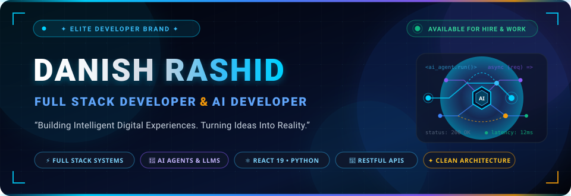

<div align="center">

  <!-- Header Banner -->
  

  <br /><br />

  <!-- Circular Profile Avatar with Glowing Tech Border -->
  <a href="https://github.com/danishalipny-pixel">
    
  </a>

  <br />

  <!-- Name & Title -->
  <h1>DANISH RASHID</h1>
  <p>
    <b>⚡ Full Stack Developer &bull; AI Developer 🤖</b>
  </p>

  <p>
    <i>&ldquo;Building modern web experiences, intelligent AI solutions &amp; scalable digital products.&rdquo;</i>
  </p>

  <!-- Animated Typing SVG -->
  <p>
    <a href="https://github.com/danishalipny-pixel">
      
    </a>
  </p>

  <!-- Quick VIP Action Buttons -->
  <p>
    <a href="https://github.com/danishalipny-pixel">
      
    </a>
    &nbsp;
    <a href="mailto:danish.ali.pny@gmail.com">
      
    </a>
    &nbsp;
    <a href="https://wa.me/923260092000" target="_blank">
      
    </a>
    &nbsp;
    <a href="https://www.linkedin.com/in/danish-rashid" target="_blank">
      
    </a>
    &nbsp;
    <a href="#-featured-projects">
      
    </a>
  </p>

</div>

<p align="center">
  
</p>

---

## 🧑‍💻 About Me

Hello! I'm **Danish Rashid**, an innovative **Full Stack Developer** and **AI Developer** driven by a passion for creating high-performance web applications and intelligent, automated digital systems.

I bridge the gap between robust software engineering and cutting-edge artificial intelligence — engineering responsive frontend interfaces, high-throughput backend APIs, structured database architectures, and autonomous AI agents powered by state-of-the-art LLMs.

```yaml
Name: Danish Rashid
Profession: Full Stack Developer + AI Developer
Core Philosophy: Clean Architecture • Scalable Systems • Autonomous AI Integration
Primary Focus: Enterprise Web Apps, LLM Integrations, AI Agents & Automation
Location: Available Globally (Remote / Worldwide)
Status: Open for High-Impact Projects & Opportunities
```

### 🎯 Core Highlights & Focus
* 🌐 **Full Stack Web Architecture**: Developing seamless, end-to-end web applications with modern frontend frameworks and reliable backend ecosystems.
* 🤖 **Artificial Intelligence & LLMs**: Architecting intelligent chatbots, context-aware assistants, and agentic workflows using OpenAI APIs and Python.
* 🔌 **RESTful APIs & Backend Services**: Engineering secure, maintainable endpoints, authentication systems, and microservices.
* ⚙️ **Process Automation**: Building automated pipelines that turn manual, repetitive tasks into autonomous workflows.
* 💾 **Reliable Data Persistence**: Designing optimized relational and NoSQL database schemas for speed, integrity, and scalability.

<p align="center">
  
</p>

---

## ⚡ Tech Stack & Tools

### 🌐 Frontend Engineering
Modern, responsive, accessible, and fluid user interfaces built for all screen sizes:

<p>
  
  
  
  
  
  
  
  
</p>

### ⚙️ Backend & API Development
Scalable server architectures, microservices, and secure RESTful endpoints:

<p>
  
  
  
  
  
  
  
</p>

### 🤖 AI, LLMs & Intelligent Agents
Intelligent systems, prompt engineering, agentic autonomy, and LLM applications:

<p>
  
  
  
  
  
  
</p>

### 💾 Databases & Data Storage
Performant schemas, querying, real-time sync, and data integrity:

<p>
  
  
  
  
  
</p>

### 🛠️ Developer Tools & Environment
Modern tooling ensuring speed, precision, and frictionless collaboration:

<p>
  
  
  
  
  
  
</p>

<p align="center">
  
</p>

---

## 🤖 AI & Intelligent Systems

Artificial intelligence is reshaping the digital frontier. I focus on developing production-ready AI applications that move beyond static chatbots to deliver dynamic reasoning, agentic tool usage, and real business utility:

* 🧠 **AI Agents & Multi-Step Workflows**: Architecting autonomous agents capable of querying tools, reasoning step-by-step, and executing tasks reliably.
* 🌐 **AI-Powered Web Applications**: Embedding intelligence directly into web apps via Python (Flask/FastAPI) and modern JavaScript interfaces.
* 💬 **Context-Aware Intelligent Chatbots**: Building conversational interfaces equipped with session persistence, history tracking, and dark-mode UX (e.g. Gradio & Web Chat).
* ⚙️ **AI Automation & Scripting**: Streamlining manual operations, document handling, and data transformation with Python automation scripts.
* 🔌 **Backend AI Integrations**: Establishing secure, rate-limited, and token-optimized backend gateways for OpenAI and modern LLM APIs.

<p align="center">
  
</p>

---

## 🌐 Full Stack Development Architecture

I engineer digital solutions across the complete development lifecycle — guaranteeing tight integration from the user interface down to data storage and server deployment:

```text
┌───────────────────────────┐      ┌───────────────────────────┐      ┌───────────────────────────┐
│     1. FRONTEND UI/UX     │      │     2. APIS & MIDDLEWARE  │      │     3. BACKEND CORE       │
│  React 19 • Vite • JS/ES6 │ ───► │  RESTful Endpoints • CORS │ ───► │  Python Flask • Node.js   │
│  HTML5 • CSS3 • Bootstrap │      │  Auth • JSON Payloads     │      │  PHP / Laravel Business   │
└───────────────────────────┘      └───────────────────────────┘      └───────────────────────────┘
                                                                                    │
                                                                                    ▼
┌───────────────────────────┐      ┌───────────────────────────┐      ┌───────────────────────────┐
│     6. DEPLOY & SCALE     │      │     5. AI & AUTOMATION    │      │     4. DATABASE LAYER     │
│  Version Control • Cloud  │ ◄─── │  OpenAI LLM • AI Agents   │ ◄─── │  MySQL • MongoDB • SQLite │
│  Performance Optimization │      │  Gradio • Python Scripts  │      │  Firebase Real-Time DB    │
└───────────────────────────┘      └───────────────────────────┘      └───────────────────────────┘
```

* **Frontend**: Highly responsive layouts, component-based architectures, and fluid animations.
* **Backend**: Clean code patterns, secure input validation, structured MVC / microservice logic.
* **Database**: Normalized schemas, optimized indexing, and robust data persistence.
* **APIs**: Documented, standardized REST APIs engineered for fast response times.

<p align="center">
  
</p>

---

## 🚀 Featured Projects

Real, verified repositories from my active GitHub profile showcasing full-stack capabilities, AI development, and responsive engineering:

<table>
  <tr>
    <td width="50%" valign="top">
      <h3 align="left">🤖 <a href="https://github.com/danishalipny-pixel/AI">Danish AI Agent</a></h3>
      <p>
        Personal conversational AI assistant and extensible agent framework engineered with a Python Flask backend, OpenAI API integration, and an interactive responsive web UI.
      </p>
      <p>
        
        
        
        
      </p>
      <p>
        🔗 <b><a href="https://github.com/danishalipny-pixel/AI">View Repository &rarr;</a></b>
      </p>
    </td>
    <td width="50%" valign="top">
      <h3 align="left">✦ <a href="https://github.com/danishalipny-pixel/Danish-Rao">AI Chat Assistant</a></h3>
      <p>
        Production-ready AI chat application powered by OpenAI GPT-4o and Gradio. Features a dark-mode UI, conversation memory within sessions, and automatic JSON conversation logging.
      </p>
      <p>
        
        
        
        
      </p>
      <p>
        🔗 <b><a href="https://github.com/danishalipny-pixel/Danish-Rao">View Repository &rarr;</a></b>
      </p>
    </td>
  </tr>
  <tr>
    <td width="50%" valign="top">
      <h3 align="left">⛅ <a href="https://github.com/danishalipny-pixel/Atmosphere">Atmosphere Weather App</a></h3>
      <p>
        Modern, lightning-fast weather intelligence web application built with React 19, Vite, and Lucide React icons, offering real-time weather analytics and clean UX.
      </p>
      <p>
        
        
        
        
      </p>
      <p>
        🔗 <b><a href="https://github.com/danishalipny-pixel/Atmosphere">View Repository &rarr;</a></b>
      </p>
    </td>
    <td width="50%" valign="top">
      <h3 align="left">🏥 <a href="https://github.com/danishalipny-pixel/hospital-website-vip">VIP Hospital Web Platform</a></h3>
      <p>
        Comprehensive, multi-page healthcare platform engineered with responsive layouts, doctor directories, patient booking flow, and clean Bootstrap styling.
      </p>
      <p>
        
        
        
        
      </p>
      <p>
        🔗 <b><a href="https://github.com/danishalipny-pixel/hospital-website-vip">View Repository &rarr;</a></b>
      </p>
    </td>
  </tr>
  <tr>
    <td width="50%" valign="top">
      <h3 align="left">✉️ <a href="https://github.com/danishalipny-pixel/Danish_">Pixel-Perfect Gmail Clone</a></h3>
      <p>
        Faithful recreation of Gmail's web client interface focusing on CSS Grid/Flexbox architecture, responsive navigation, and pixel-level frontend precision.
      </p>
      <p>
        
        
        
      </p>
      <p>
        🔗 <b><a href="https://github.com/danishalipny-pixel/Danish_">View Repository &rarr;</a></b>
      </p>
    </td>
    <td width="50%" valign="top">
      <h3 align="left">🐍 <a href="https://github.com/danishalipny-pixel/snake-game">Classic Arcade Snake Game</a></h3>
      <p>
        Interactive arcade video game built in Python featuring real-time collision calculation, score incrementing, dynamic speed scaling, and game-loop state handling.
      </p>
      <p>
        
        
        
      </p>
      <p>
        🔗 <b><a href="https://github.com/danishalipny-pixel/snake-game">View Repository &rarr;</a></b>
      </p>
    </td>
  </tr>
</table>

<p align="center">
  
</p>

---

## 📊 GitHub Analytics & Activity

<div align="center">
  <table border="0">
    <tr>
      <td align="center" valign="middle">
        <a href="https://github.com/danishalipny-pixel">
          
        </a>
      </td>
      <td align="center" valign="middle">
        <a href="https://github.com/danishalipny-pixel">
          
        </a>
      </td>
    </tr>
    <tr>
      <td colspan="2" align="center" valign="middle">
        <br />
        <a href="https://github.com/danishalipny-pixel">
          
        </a>
      </td>
    </tr>
  </table>
</div>

<p align="center">
  
</p>

---

## 🎯 Currently Building

* ⚡ **Production-Grade Full Stack Applications**: Architecting robust web apps featuring React 19 frontends and Python/Node backends.
* 🤖 **Autonomous AI Agents**: Experimenting with multi-agent coordination, external function calling, and structured output generation.
* 💬 **Enterprise AI Chatbots**: Building conversational interfaces with vector retrieval (RAG) and session memory.
* ⚙️ **Workflow Automation Systems**: Automating enterprise business processes using Python background services.
* 🔌 **High-Throughput REST APIs**: Implementing strict authentication, rate-limiting, and microservices architecture.
* 📱 **Modern High-Converting Websites**: Creating ultra-responsive, mobile-first websites optimized for speed and SEO.

<p align="center">
  
</p>

---

## 📈 Developer Journey

A disciplined, continuous cycle of growth, technical mastery, and shipping real-world value:

```text
  ┌──────────────┐       ┌──────────────┐       ┌──────────────┐       ┌──────────────┐
  │   01. LEARN  │ ────► │  02. BUILD   │ ────► │  03. DEPLOY  │ ────► │ 04. OPTIMIZE │
  │  New AI & JS │       │  Full Stack  │       │  Production  │       │  Scale, Refactor│
  │  Frameworks  │       │  Solutions   │       │  & Testing   │       │  & Automate  │
  └──────────────┘       └──────────────┘       └──────────────┘       └──────────────┘
```

* **01. Learn**: Constantly staying at the forefront of AI models, API updates, and cutting-edge web frameworks.
* **02. Build**: Translating theoretical knowledge into clean, tested, functional codebases and intelligent systems.
* **03. Deploy**: Shipping applications to live servers and repositories with security and clean structure.
* **04. Optimize**: Continuous profiling, code refactoring, speed optimization, and workflow automation.

<p align="center">
  
</p>

---

## 💼 What I Can Build (Services)

Available for contract, freelance, and dedicated engineering roles:

| Category | Description | Key Deliverables |
| :--- | :--- | :--- |
| 🌐 **Full Stack Websites** | Complete web applications built from scratch | Responsive Frontend + Secure Backend + Database |
| 🤖 **AI Applications** | Intelligent software powered by advanced LLMs | OpenAI Integrations, Flask/FastAPI Backends |
| 💬 **AI Chatbots** | Custom assistants tailored for user engagement | Dark-Mode UI, Session Memory, Context Logging |
| ⚙️ **AI Automation** | Custom automation pipelines to replace manual tasks | Python Automation, Data Processing, Bots |
| 🔌 **REST APIs** | Secure, documented, and high-performance endpoints | JSON APIs, Authentication, CRUD Operations |
| 🐛 **Bug Fixing & Debugging** | Resolving code errors, performance bottlenecks & UI flaws | Code Refactoring, Speed Tuning, Error Resolution |
| 📱 **Responsive Web Apps** | Pixel-perfect interfaces that look stunning on every screen | Mobile-First Layouts, Cross-Browser Compatibility |
| 🛠️ **Website Maintenance** | Continuous support, feature enhancements & updates | Security Updates, Dependency Upgrades, Optimization |

<p align="center">
  
</p>

---

## 📞 Let's Build Something Amazing Together 🚀

Have an ambitious project in mind, need an intelligent AI agent, or looking to build a high-performance web application? Let's connect and make it a reality.

<div align="center">

  <br />

  <a href="mailto:danish.ali.pny@gmail.com">
    
  </a>
  &nbsp;&nbsp;
  <a href="https://wa.me/923260092000" target="_blank">
    
  </a>
  &nbsp;&nbsp;
  <a href="https://github.com/danishalipny-pixel">
    
  </a>
  &nbsp;&nbsp;
  <a href="https://www.linkedin.com/in/danish-rashid" target="_blank">
    
  </a>

  <br /><br />

  <p>
    <sub>Designed &amp; Engineered with precision by <b>Danish Rashid</b> &bull; Full Stack Developer &amp; AI Developer</sub>
  </p>

</div>
